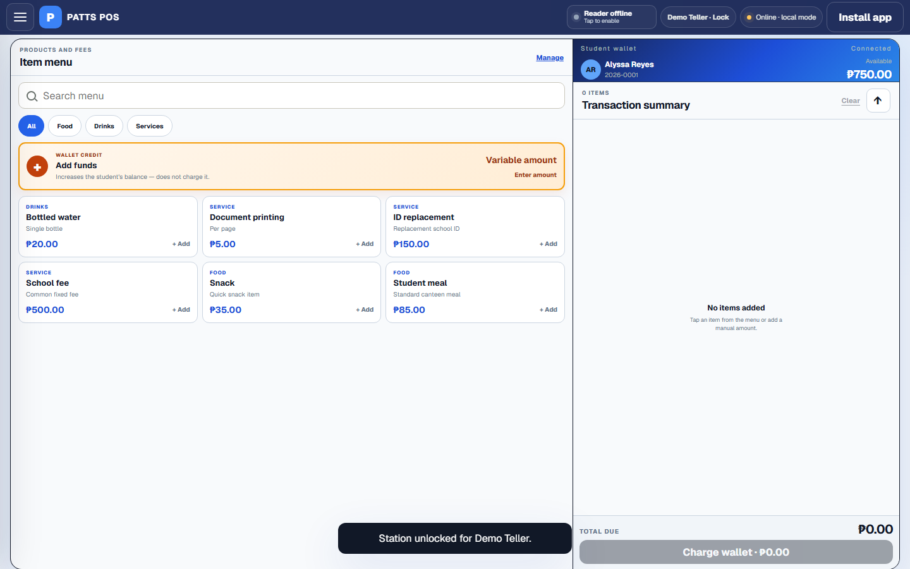
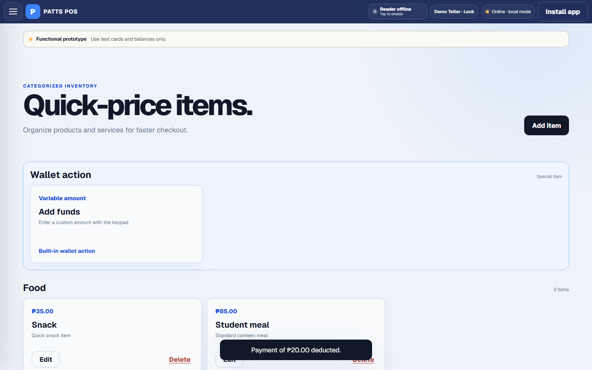
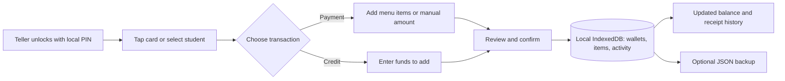

# PATTS Offline POS 0.8.2

PATTS POS is an offline student wallet and teller checkout prototype for Android tablets and browsers. This repository reflects the **0.8.2 APK** from the [PATTS Drive folder](https://drive.google.com/drive/folders/1n4uxS8JMTjfYlQNxGQg7GoL-anRPOfo3) and the original Orca PATTS project. Download the APK from this repository's [v0.8.2 release](https://github.com/Ramyl-Salazar/PATTS-POS/releases/tag/v0.8.2). The APK SHA-256 is `EBF6DEC1780E90F8C4C1D5C60CDF634A36882578EEAB082757297E2015DD4153`.

The main screen combines a student wallet, item menu, order summary, and payment controls. Tellers can add funds, charge listed items or a manual amount, manage students and item prices, view activity, and export or restore local data. A PIN protects teller access. The app ships with 20 synthetic student wallets for demonstration.

## Screenshots and videos

| Checkout | Students |
| --- | --- |
|  |  |

| Items | Activity |
| --- | --- |
|  |  |

See the [mobile checkout](docs/screenshots/wallet-mobile.png), [mobile students](docs/screenshots/students-mobile.png), [teller setup](docs/screenshots/teller-setup.png), [payment confirmation](docs/screenshots/transaction-confirmation.png), and [settings](docs/screenshots/settings-desktop.png). Watch the [43-second client demo](docs/videos/client-demo.mp4), [desktop tour](docs/videos/desktop-tour.mp4), or [mobile tour](docs/videos/mobile-tour.mp4). The client demo is captioned and silent; all captures use synthetic demo data.

## How it works



The Android app can read supported NFC-X USB reader cards through its native plugin. On a PC, Chrome or Edge can use WebHID, and the tablet emulator can use a local reader bridge. A simulated tap remains available where hardware is unavailable. Card linking and repair save identifiers locally; they do not write to cards. See [architecture and reader flow](docs/architecture.md).

## Run and validate

```powershell
npm ci
npm run dev
```

Open `http://localhost:4173/`. For a separate check, run `npm run verify:fast` (54 tests, build, web smoke) or `npm run verify:android` with Android Studio and SDK installed. To build a new debug APK, run `npm run android:apk`; the project packages the result under `dist/`.

The published APK is a debug build for demonstration, not real money or production deployment. Data is local to the device and can be lost if app storage is cleared or the app is uninstalled. Export a backup before replacing devices. Physical reader and tablet behavior still needs testing with the actual hardware.
