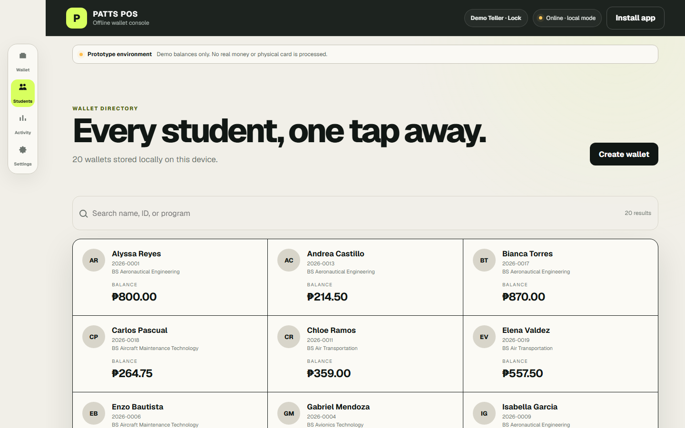
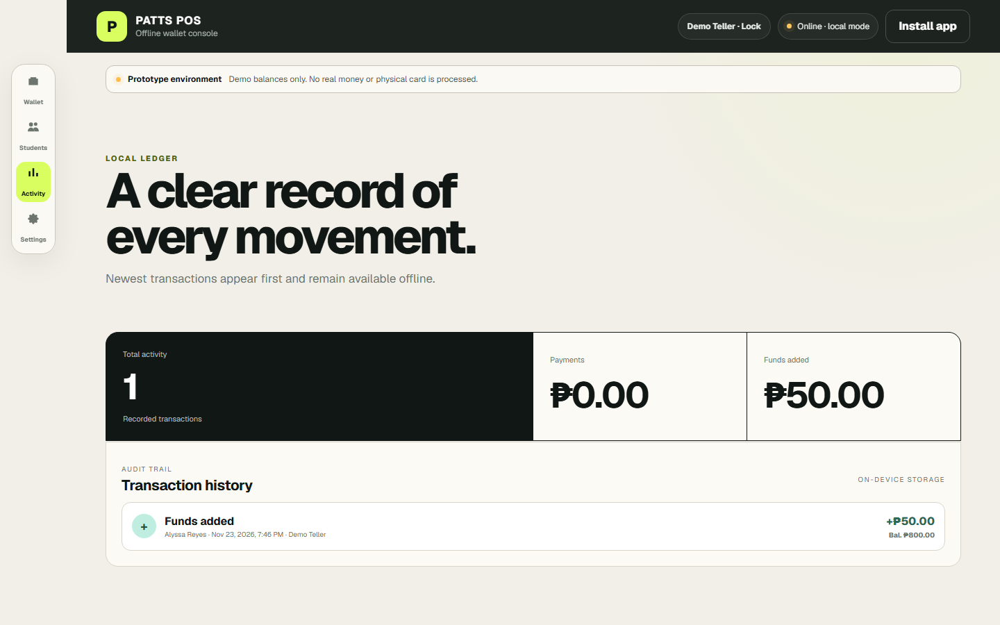
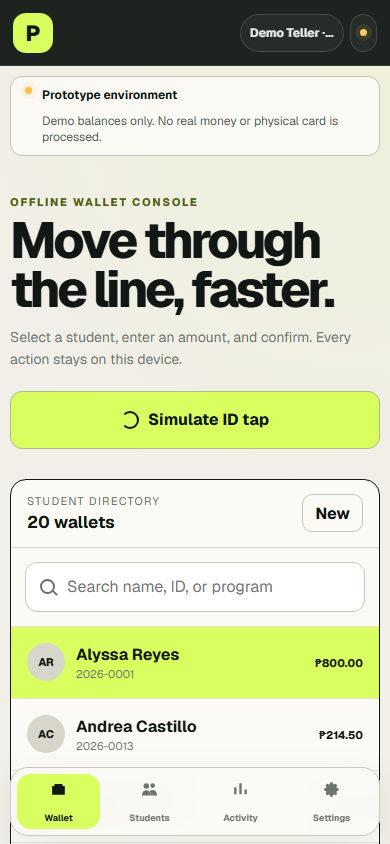
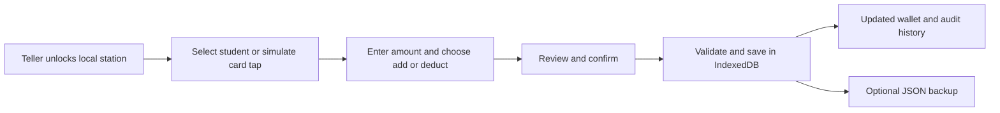

# PATTS Offline POS Prototype

An Android and browser prototype for a reloadable student wallet. It bundles
all application assets into the APK, stores records locally, and continues to
work with Wi-Fi and mobile data disabled. Until the RFID/NFC hardware is
available, the teller can simulate a card tap or select a student manually.

Implemented features include teller PIN access, 20 preloaded student wallets,
name/ID/program search, student wallet creation, add/deduct operations with
confirmation, insufficient-balance protection, named-teller audit history,
local JSON backup/restore, and demo-data reset.

## Screenshots and walkthroughs

| Wallet console | Student directory |
| --- | --- |
|  |  |

| Activity history | Mobile wallet |
| --- | --- |
|  |  |

More screens: [teller setup](docs/screenshots/teller-setup.png), [transaction confirmation](docs/screenshots/transaction-confirmation.png), [settings](docs/screenshots/settings-desktop.png), and [mobile student directory](docs/screenshots/students-mobile.png).

Videos: [desktop tour](docs/videos/desktop-tour.mp4) · [mobile tour](docs/videos/mobile-tour.mp4). All captures use a fresh, synthetic demo profile.

## How it works



See the [full workflow and architecture diagram](docs/architecture.md) for storage and Android packaging.

## Install the Android APK

After building the APK, use `dist/PATTS-POS-prototype-v0.2-debug.apk`. Copy it to
the phone, open it, and allow **Install unknown apps** for the file manager when
Android asks. This debug build supports Android 7.0 (API 24) and newer.

On first launch, create a teller name and a 4–8 digit PIN. Records and the
one-way PIN hash stay on that Android device. Use **Settings → Export backup**
before uninstalling the app or clearing its storage.

## Run locally

```powershell
npm run dev
```

Open `http://localhost:4173`. The browser version is useful for development;
the APK is the intended Android prototype.

## Build the APK

Android Studio with the Android SDK is required.

```powershell
npm install
npm run android:apk
```

The Gradle output is written under `android/app/build/outputs/apk/debug/`.

## Validate

```powershell
npm test
```

## Prototype limitations

- RFID/NFC/USB card reading is simulated until the reader and cards can be
  tested. The scan action is isolated so a native hardware adapter can replace
  it without rewriting the wallet transaction logic.
- There is no server synchronization or real-money settlement.
- Teller PIN access protects normal app use but the local database is not yet
  encrypted against a rooted device or advanced forensic access.
- The APK uses a development/debug signature and must be release-signed before
  pilot distribution.
- Clearing app storage or uninstalling deletes records unless a JSON backup was
  exported.
