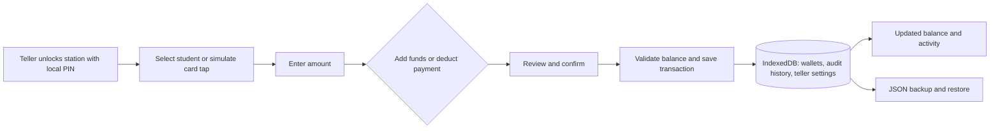
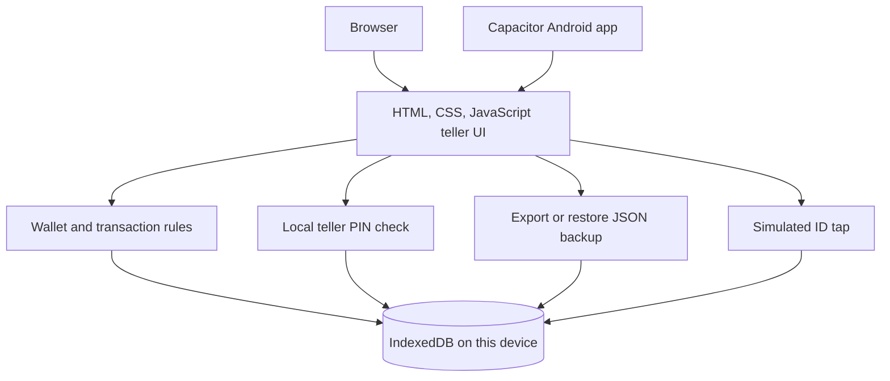

# How PATTS POS works

PATTS POS is a local prototype for a reloadable student wallet. Its teller interface is available in the browser and bundled into the Android app. The card reader is simulated until hardware integration is tested.

## Components and data

The app seeds 20 demonstration wallets on first use. Each confirmed add or deduct action updates the wallet and writes an audit record with the teller name. The backup contains wallet, transaction, and local teller-setting records, so it should be handled as sensitive data even in a pilot.

There is no server synchronization, real-money settlement, or working RFID/NFC reader. See the [README](../README.md#prototype-limitations) for deployment limits.
