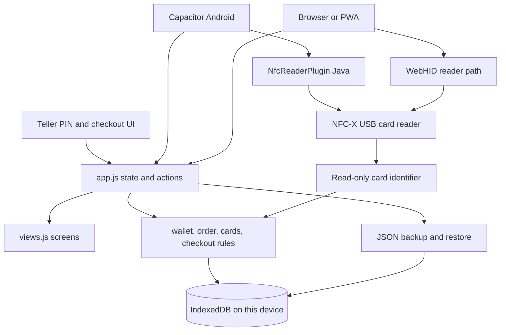

# PATTS POS 0.8.2 architecture

## Checkout

1. Teller unlocks the station with a local PIN.
2. A card read or manual student selection opens a wallet.
3. Menu items and manual amounts form an order. Add funds is a separate credit action.
4. The teller reviews the amount and confirms. The app validates the balance and writes the transaction and new wallet balance atomically to IndexedDB.
5. Activity records the teller and transaction. A JSON backup can export wallet, item, and transaction data; it excludes the local PIN verifier.

## Reader and repair

Supported NFC-X readers use a read-only USB path on Android. Desktop browsers can use WebHID, and the development emulator can use the local Windows bridge. When no reader is available, the app offers a simulated card tap. Unknown identifiers require explicit enrollment or repair; the teller must select and verify the student. A repaired card keeps its original identifier plus confirmed alternates. The app rejects identifier collisions and limits repair history. Support reports contain reader events and identifiers without student names, balances, or PINs.

The app has no server synchronization or settlement service. Hardware validation on the physical tablet and reader remains necessary.
